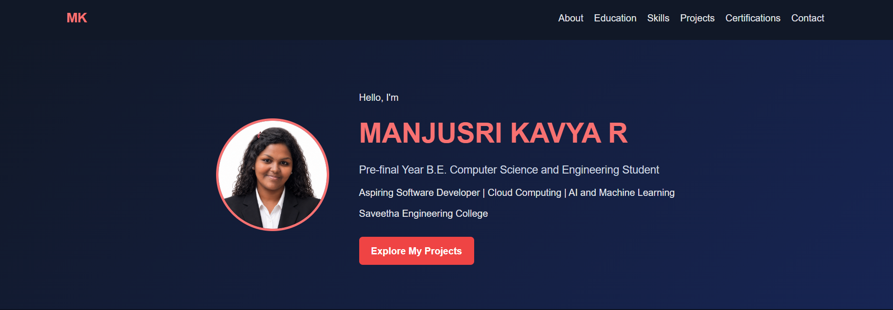
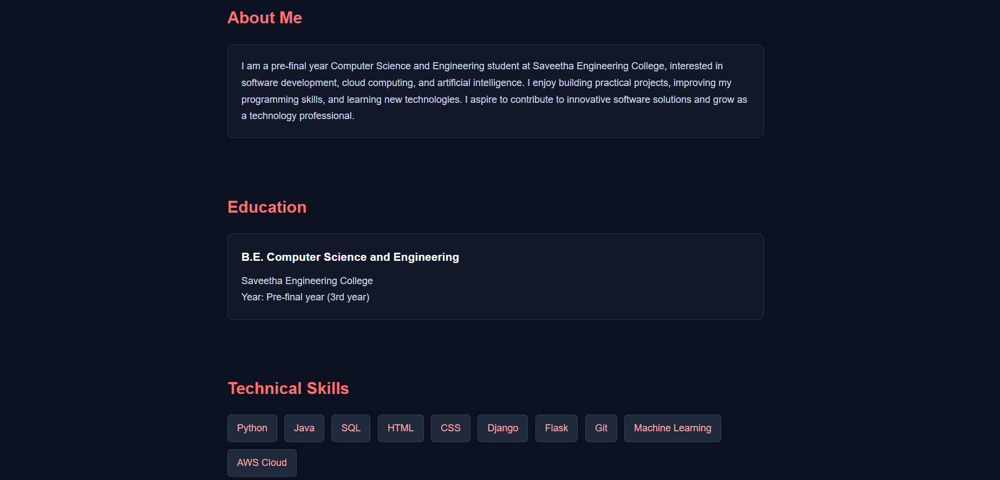
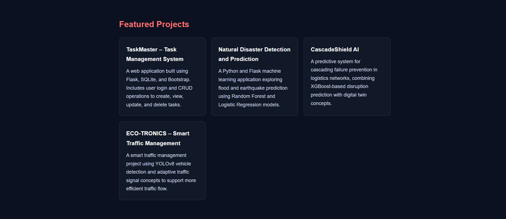
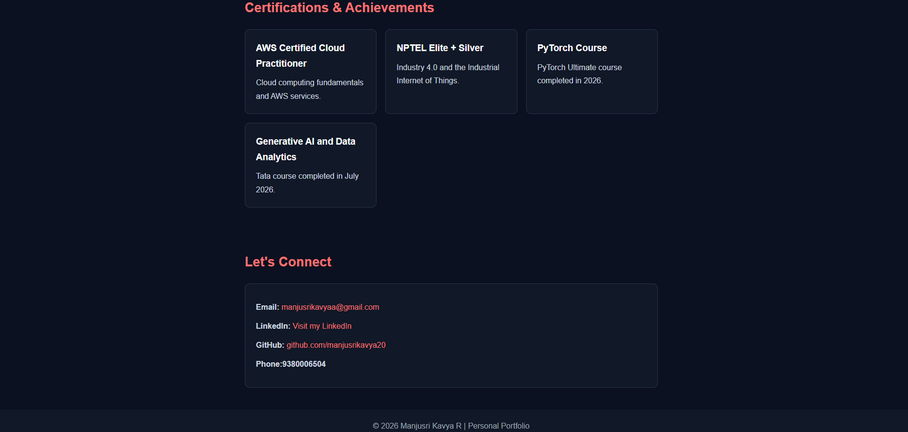

# Ex01 Portfolio
## Date: 27/10/2026

## AIM
To create a Portfolio using HTML and CSS.

## ALGORITHM
### STEP 1
Create an HTML file (index.html)

### STEP 2
Create a CSS file (style.css)

### STEP 3
Include a navigation bar with links to different sections.

### STEP 4
Add structured sections for introduction, about, projects, and contact details.

### STEP 5
Define global styles for fonts, colors, and layout.

### STEP 6
Style the header, navigation bar, and sections.

### STEP 7
Use Flexbox or CSS Grid for layout design.

### STEP 8
Add hover effects and transitions for interactivity.

### STEP 9
Add Images and Media.

### STEP 10
Use optimized images for a professional look.

### STEP 11
Open the HTML file in a browser to check layout and functionality.

### STEP 12
Fix styling issues and refine content placement.

### STEP 13
Deploy the Portfolio.

### STEP 14
Upload to GitHub Pages for free hosting.

## PROGRAM
```

<!DOCTYPE html>
<html lang="en">
<head>
    <meta charset="UTF-8">
    <meta name="viewport" content="width=device-width, initial-scale=1.0">
    <title>MANJUSRI KAVYA R | Portfolio</title>

    <style>
        * {
            margin: 0;
            padding: 0;
            box-sizing: border-box;
            scroll-behavior: smooth;
        }

        body {
            font-family: Arial, sans-serif;
            background: #0b1120;
            color: #e5e7eb;
            line-height: 1.7;
        }

        header {
            background: #111827;
            padding: 18px 8%;
            display: flex;
            justify-content: space-between;
            align-items: center;
            flex-wrap: wrap;
            gap: 12px;
        }

        .logo {
            color: #f87171;
            font-size: 22px;
            font-weight: bold;
        }

        nav {
            display: flex;
            flex-wrap: wrap;
            gap: 18px;
        }

        nav a, a {
            color: #f87171;
            text-decoration: none;
        }

        nav a {
            color: #e5e7eb;
        }

        nav a:hover, a:hover {
            color: #f87171;
        }

        .hero {
            padding: 75px 8%;
            display: flex;
            align-items: center;
            justify-content: center;
            gap: 50px;
            flex-wrap: wrap;
            background: linear-gradient(135deg, #111827, #172554);
        }

        .hero img {
            width: 190px;
            height: 190px;
            border-radius: 50%;
            object-fit: cover;
            border: 4px solid #f87171;
        }

        .hero-text {
            max-width: 600px;
        }

        .hero h1 {
            font-size: clamp(30px, 5vw, 46px);
            margin-bottom: 8px;
        }

        .hero h1,h2 {
            color: #f87171;
        }

        .hero p {
            margin: 8px 0;
        }

        .tagline {
            color: #cbd5e1;
            font-size: 18px;
        }

        .button {
            display: inline-block;
            margin-top: 18px;
            padding: 10px 20px;
            background: #ef4444;
            color: white;
            border-radius: 6px;
            font-weight: bold;
        }

        .button:hover {
            background: #dc2626;
            color: white;
        }

        section {
            padding: 45px 8%;
            max-width: 1150px;
            margin: auto;
        }

        h2 {
            font-size: 27px;
            margin-bottom: 20px;
        }

        .card {
            background: #111827;
            border: 1px solid #293449;
            padding: 22px;
            border-radius: 10px;
        }

        .grid {
            display: grid;
            grid-template-columns: repeat(auto-fit, minmax(230px, 1fr));
            gap: 18px;
        }

        .card h3 {
            margin-bottom: 10px;
            color: #f9fafb;
        }

        .card p {
            color: #cbd5e1;
        }

        .skills {
            display: flex;
            flex-wrap: wrap;
            gap: 12px;
        }

        .skills span {
            background: #1e293b;
            color: #fca5a5;
            padding: 8px 15px;
            border-radius: 6px;
            border: 1px solid #374151;
        }

        .contact p {
            margin: 12px 0;
            overflow-wrap: anywhere;
        }

        footer {
            text-align: center;
            background: #111827;
            padding: 20px;
            color: #9ca3af;
        }

        @media (max-width: 600px) {
            header {
                justify-content: center;
            }

            nav {
                justify-content: center;
                gap: 12px;
            }

            .hero {
                text-align: center;
                padding: 45px 6%;
                gap: 22px;
            }

            section {
                padding: 35px 6%;
            }
        }
    </style>
</head>

<body>

<header>
    <div class="logo">MK</div>
    <nav>
        <a href="#about">About</a>
        <a href="#education">Education</a>
        <a href="#skills">Skills</a>
        <a href="#projects">Projects</a>
        <a href="#certifications">Certifications</a>
        <a href="#contact">Contact</a>
    </nav>
</header>

<div class="hero">
    

    <div class="hero-text">
        <p>Hello, I'm</p>
        <h1>MANJUSRI KAVYA R</h1>
        <p class="tagline">
            Pre-final Year B.E. Computer Science and Engineering Student
        </p>
        <p>
            Aspiring Software Developer | Cloud Computing |
            AI and Machine Learning
        </p>
        <p>Saveetha Engineering College</p>
        <a class="button" href="#projects">Explore My Projects</a>
    </div>
</div>

<section id="about">
    <h2>About Me</h2>
    <div class="card">
        <p>
            I am a pre-final year Computer Science and Engineering
            student at Saveetha Engineering College, interested in
            software development, cloud computing, and artificial
            intelligence. I enjoy building practical projects,
            improving my programming skills, and learning new
            technologies. I aspire to contribute to innovative
            software solutions and grow as a technology professional.
        </p>
    </div>
</section>

<section id="education">
    <h2>Education</h2>
    <div class="card">
        <h3>B.E. Computer Science and Engineering</h3>
        <p>Saveetha Engineering College</p>
        <p>Year: Pre-final year (3rd year)</p>
    </div>
</section>

<section id="skills">
    <h2>Technical Skills</h2>
    <div class="skills">
        <span>Python</span>
        <span>Java</span>
        <span>SQL</span>
        <span>HTML</span>
        <span>CSS</span>
        <span>Django</span>
        <span>Flask</span>
        <span>Git</span>
        <span>Machine Learning</span>
        <span>AWS Cloud</span>
    </div>
    <p style="margin-top:15px;color:#9ca3af">
    </p>
</section>

<section id="projects">
    <h2>Featured Projects</h2>
    <div class="grid">

        <div class="card">
            <h3>TaskMaster – Task Management System</h3>
            <p>
                A web application built using Flask, SQLite, and
                Bootstrap. Includes user login and CRUD operations
                to create, view, update, and delete tasks.
            </p>
        </div>

        <div class="card">
            <h3>Natural Disaster Detection and Prediction</h3>
            <p>
                A Python and Flask machine learning application
                exploring flood and earthquake prediction using
                Random Forest and Logistic Regression models.
            </p>
        </div>

        <div class="card">
            <h3>CascadeShield AI</h3>
            <p>
                A predictive system for cascading failure prevention
                in logistics networks, combining XGBoost-based
                disruption prediction with digital twin concepts.
            </p>
        </div>

        <div class="card">
            <h3>ECO-TRONICS – Smart Traffic Management</h3>
            <p>
                A smart traffic management project using YOLOv8
                vehicle detection and adaptive traffic signal
                concepts to support more efficient traffic flow.
            </p>
        </div>

    </div>
</section>

<section id="certifications">
    <h2>Certifications & Achievements</h2>
    <div class="grid">
        <div class="card">
            <h3>AWS Certified Cloud Practitioner</h3>
            <p>Cloud computing fundamentals and AWS services.</p>
        </div>

        <div class="card">
            <h3>NPTEL Elite + Silver</h3>
            <p>Industry 4.0 and the Industrial Internet of Things.</p>
        </div>

        <div class="card">
            <h3>PyTorch Course</h3>
            <p>PyTorch Ultimate course completed in 2026.</p>
        </div>

        <div class="card">
            <h3>Generative AI and Data Analytics</h3>
            <p>Tata course completed in July 2026.</p>
        </div>
    </div>
</section>

<section id="contact" class="contact">
    <h2>Let's Connect</h2>
    <div class="card">
        <p>
            <strong>Email:</strong>
            <a href="manjusrikavyaa@gmail.com">
                manjusrikavyaa@gmail.com
            </a>
        </p>

        <p>
            <strong>LinkedIn:</strong>
            <a href="https://www.linkedin.com/in/manjusrikavya" target="_blank"
               rel="noopener noreferrer">
                Visit my LinkedIn
            </a>
        </p>

        <p>
            <strong>GitHub:</strong>
            <a href="https://github.com/manjusrikavya20"
               target="_blank" rel="noopener noreferrer">
                github.com/manjusrikavya20
            </a>
        </p>

        <p>
            <strong>Phone:9380006504</strong>
        </p>
    </div>
</section>

<footer>
    <p>© 2026 Manjusri Kavya R | Personal Portfolio</p>
</footer>

</body>
</html>
```

## OUTPUT









## RESULT
The program for creating Portfolio using HTML and CSS is executed successfully.